<p align="center">
  
</p>

<h1 align="center">osTicket – Prerequisites & Installation (Lab)</h1>

<p align="center">
  End-to-end technical deployment of the osTicket help desk system on Microsoft Azure
</p>

---

## 📌 Overview

This lab demonstrates the **full technical installation and configuration** of **osTicket**, an open-source help desk ticketing system, deployed on a **Microsoft Azure-hosted Windows virtual machine**.

The walkthrough documents each step performed during deployment, including virtual machine provisioning, IIS configuration, PHP installation, MySQL database setup, and osTicket installation.

All screenshots were captured **during execution** to demonstrate how the system was built from start to finish.

---

## 🖥️ Environment

- Microsoft Azure (Virtual Machines)
- Windows 11 Pro
- Internet Information Services (IIS) with CGI
- PHP 7.3.8
- MySQL Server 5.5
- Remote Desktop Protocol (RDP)
- HeidiSQL

---

## ⚙️ Installation & Configuration Steps

---

### Step 1: Provision the Azure Virtual Machine

**Goal:** Create a Windows 11 VM in Microsoft Azure to host the osTicket environment.

**Procedure:**

1. Sign in to the [Azure Portal](https://portal.azure.com) and click **Create a resource**.
2. Search for **Virtual Machine** and click **Create**.
3. On the **Basics** tab, configure:
   - **Resource group:** `osticket-lab-rg` (create new)
   - **Virtual machine name:** `osticket-vm`
   - **Region:** `(US) East US`
   - **Image:** `Windows 11 Pro`
   - **Size:** `Standard_B2s` (2 vCPU, 4 GiB)
   - **Username:** `labadmin`
   - **Password:** (strong password, saved securely)
4. On the **Networking** tab, set **Inbound port rules** to allow **RDP (3389)**.
5. Click **Review + create** → **Create**. Wait ~3–5 minutes for deployment.
6. Confirm the VM shows **Running** on its overview page.

**Result:** The VM is provisioned and running in Azure.

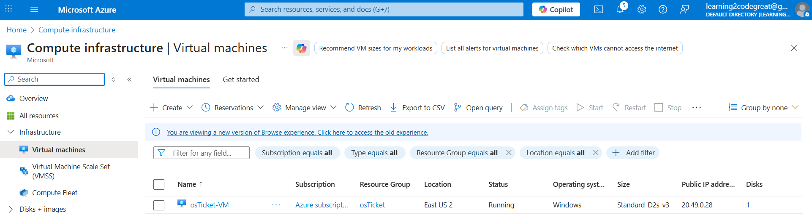
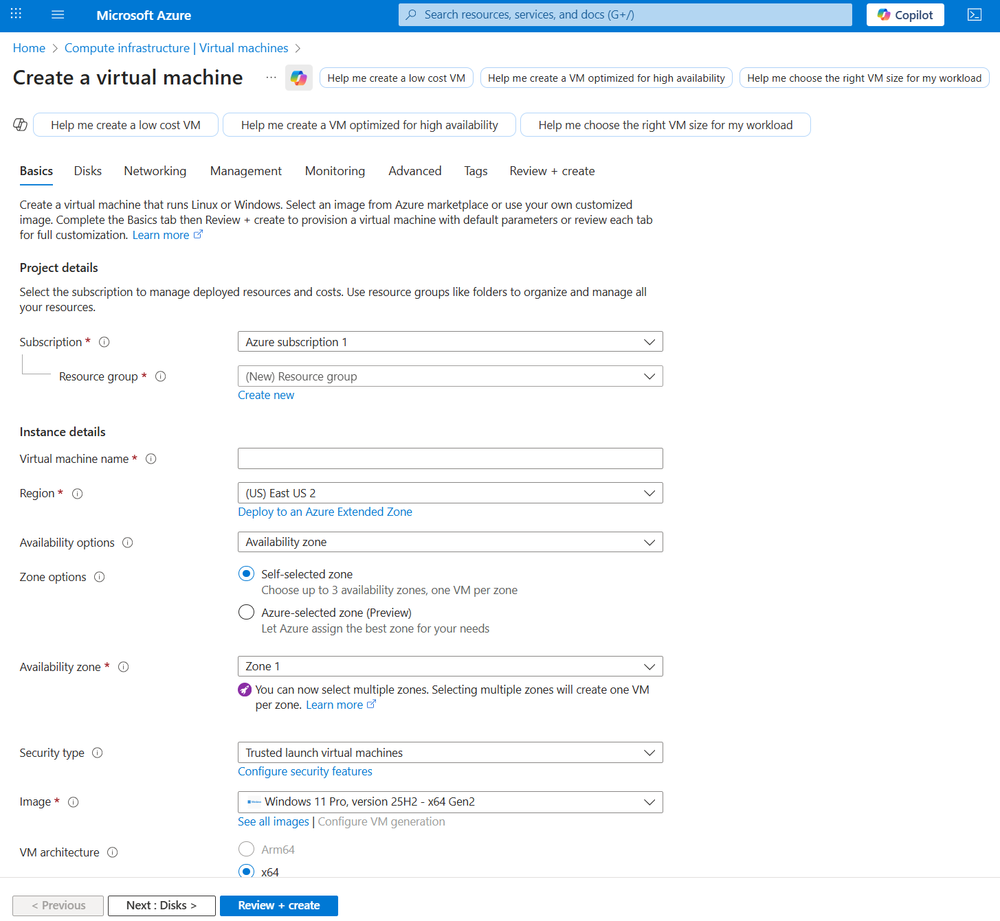
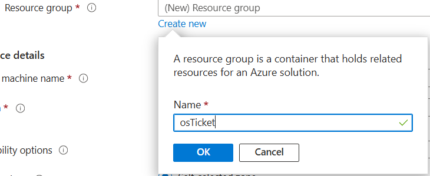

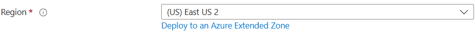
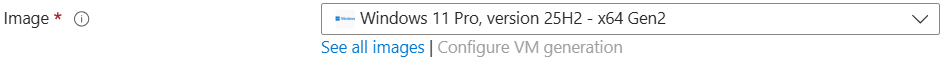
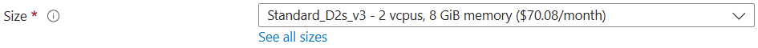
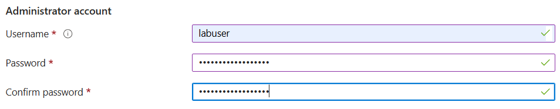
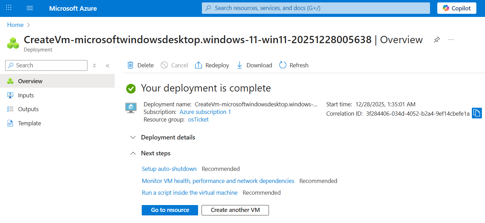

---

### Step 2: Connect via Remote Desktop

**Goal:** Establish an RDP session to the Azure VM so configuration can begin.

**Procedure:**

1. In the Azure Portal, open the `osticket-vm` overview page.
2. Click **Connect** → **RDP**.
3. Click **Download RDP File**.
4. Open the downloaded `.rdp` file.
5. When prompted, enter the VM credentials:
   - **Username:** `labadmin`
   - **Password:** (the password set during VM creation)
6. Accept the certificate warning if prompted (expected for a new VM).
7. Wait for the Windows desktop to load.

**Result:** An active Remote Desktop session showing the Windows 11 desktop of the Azure VM.

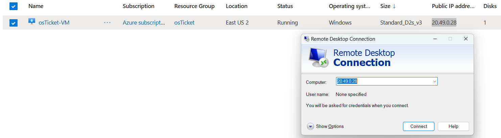
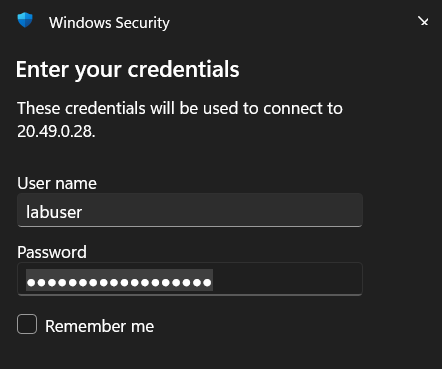
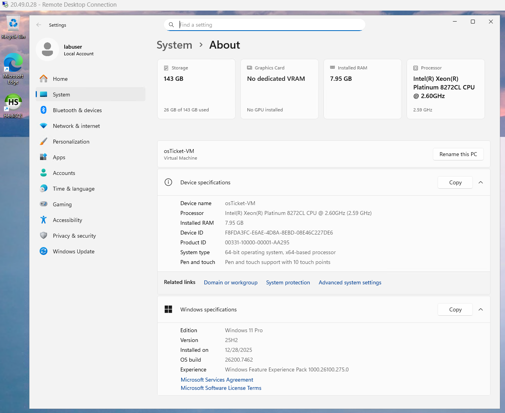

---

### Step 3: Download osTicket Installation Files

**Goal:** Obtain the osTicket package and extract it inside the VM.

**Procedure:**

1. Inside the RDP session, open Microsoft Edge.
2. Navigate to the osTicket releases page: `https://osticket.com/download/`.
3. Download the latest **osTicket v1.x** `.zip` package.
4. Once downloaded, right-click the `.zip` → **Extract All…**
5. Set the destination to `C:\osticket-install\` and click **Extract**.
6. Open the extracted folder and confirm you see the `upload` and `include` folders.

**Result:** The osTicket files are extracted locally on the VM, ready for deployment.

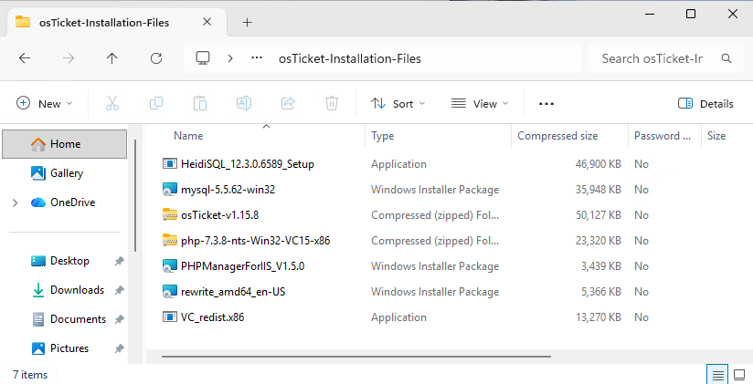
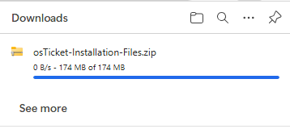
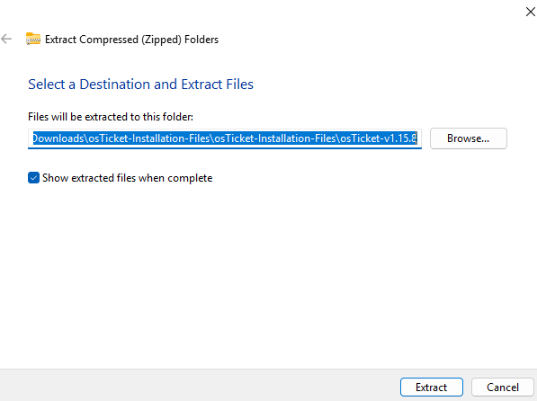
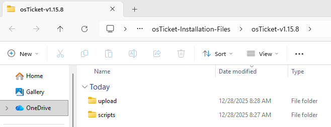

---

### Step 4: Install IIS with CGI Enabled

**Goal:** Install Internet Information Services (IIS) with the CGI feature enabled so IIS can execute PHP.

**Procedure:**

1. Inside the RDP session, open **Server Manager**.
2. Click **Add roles and features**.
3. Click **Next** through the wizard until you reach **Server Roles**.
4. Check **Web Server (IIS)** → click **Add Features** when prompted.
5. Click **Next** through to **Role Services**.
6. Expand **Application Development** and check **CGI**.
7. Click **Next** → **Install**. Wait for the installation to complete.
8. Click **Close** when finished.

**Result:** IIS is installed with CGI enabled, ready to host PHP.

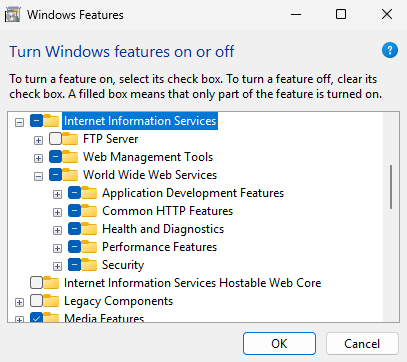

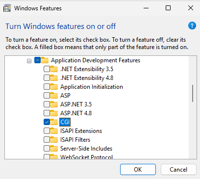

---

### Step 5: Install IIS Dependencies

**Goal:** Install PHP Manager for IIS and the IIS URL Rewrite Module — both required for osTicket to run correctly.

**Procedure:**

1. Inside the RDP session, download the **PHP Manager for IIS** installer.
2. Run the installer → **Next** → accept the license → **Install** → **Finish**.
3. Download the **IIS URL Rewrite Module 2** installer.
4. Run the installer → accept the license → **Install** → **Finish**.
5. Close and reopen **IIS Manager** (`inetmgr`) so the new modules load.
6. Confirm **PHP Manager** appears in the IIS Manager home page.

**Result:** Both dependencies are installed and PHP Manager is visible in IIS Manager.

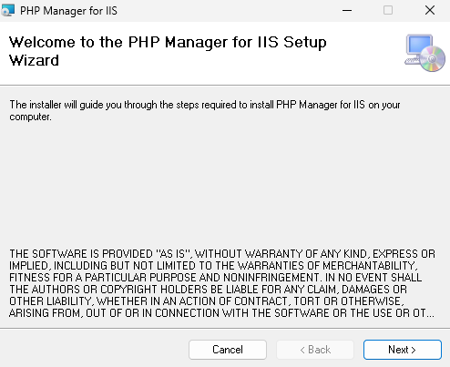

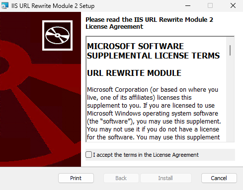

---

### Step 6: Install PHP Runtime

**Goal:** Install PHP 7.3.8 to `C:\PHP` so IIS can execute PHP scripts.

**Procedure:**

1. Inside the RDP session, create the folder `C:\PHP`.
2. Download the **PHP 7.3.8 (x64) Non-Thread-Safe** ZIP from `windows.php.net/downloads/releases/archives/`.
3. Right-click the ZIP → **Extract All…**
4. Set the destination to `C:\PHP` and click **Extract**.
5. Confirm `C:\PHP\php-cgi.exe` exists (this is the binary IIS will call).
6. Copy `php.ini-production` to `php.ini` in the same folder.

**Result:** PHP 7.3.8 is extracted to `C:\PHP` with a working `php.ini`.

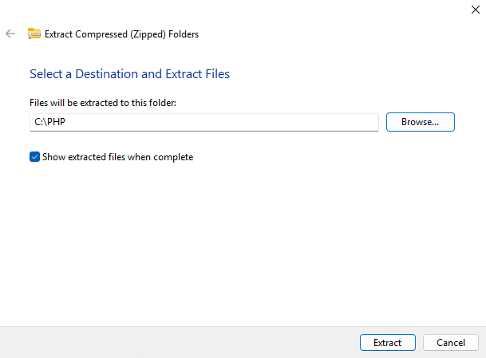

---

### Step 7: Install Microsoft Visual C++ Redistributable

**Goal:** Install the Visual C++ Redistributable required by PHP and MySQL.

**Procedure:**

1. Inside the RDP session, download the **Microsoft Visual C++ Redistributable** installer (x64).
2. Run the installer.
3. Check **I agree to the license terms and conditions**.
4. Click **Install**.
5. Wait for setup to complete, then click **Close**.

**Result:** The Visual C++ Redistributable is installed, satisfying the runtime dependency for PHP and MySQL.

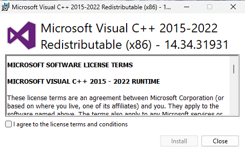

---

### Step 8: Install MySQL Server

**Goal:** Install MySQL Server to serve as the backend database for osTicket.

**Procedure:**

1. Inside the RDP session, download the **MySQL Server 5.5** installer.
2. Run the installer and click **Next** through the welcome screen.
3. Accept the license agreement → **Next**.
4. Choose **Typical** setup type → **Install**.
5. Wait for installation to complete → **Next** → **Finish**.
6. When the configuration wizard launches, select **Standard Configuration** → **Next**.
7. Check **Install As Windows Service** (leave the default service name `MySQL`) → **Next**.
8. Set a **root password** (save it — needed later for HeidiSQL) → **Next** → **Execute**.
9. Click **Finish** once configuration completes.

**Result:** MySQL Server is installed, running as a Windows service, with a known root password.

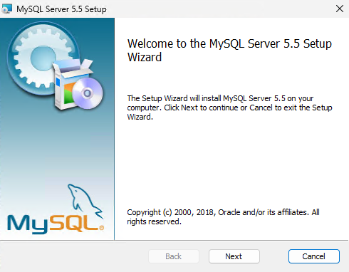

---

### Step 9: Register PHP in IIS

**Goal:** Register PHP with IIS via PHP Manager so IIS can execute `.php` files.

**Procedure:**

1. Inside the RDP session, open **IIS Manager** (`inetmgr`).
2. Click the server name in the left tree.
3. In the center pane, double-click **PHP Manager**.
4. Click **Register new PHP version**.
5. In the dialog, click the **`…`** button and browse to `C:\PHP\php-cgi.exe`.
6. Click **OK** to register.
7. Confirm the PHP version now appears in PHP Manager.

**Result:** PHP 7.3.8 is registered with IIS and listed in PHP Manager.

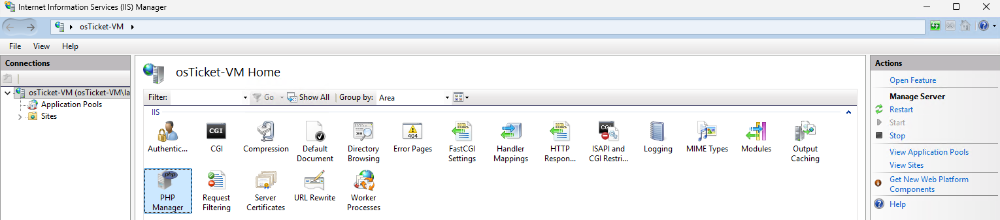

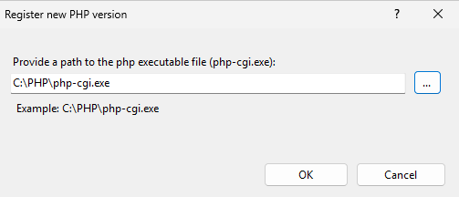

---

### Step 10: Deploy osTicket Application Files

**Goal:** Copy the osTicket `upload` folder into IIS's web root and rename it to `osTicket`.

**Procedure:**

1. Inside the RDP session, open **File Explorer**.
2. Navigate to the extracted osTicket folder (from Step 3).
3. Copy the `upload` folder.
4. Paste it into `C:\inetpub\wwwroot\`.
5. Confirm `C:\inetpub\wwwroot\upload\` now exists.
6. Right-click the `upload` folder → **Rename** → change it to `osTicket`.
7. Confirm the path is now `C:\inetpub\wwwroot\osTicket\`.

**Result:** osTicket application files are deployed at `C:\inetpub\wwwroot\osTicket\`, ready for the web installer.

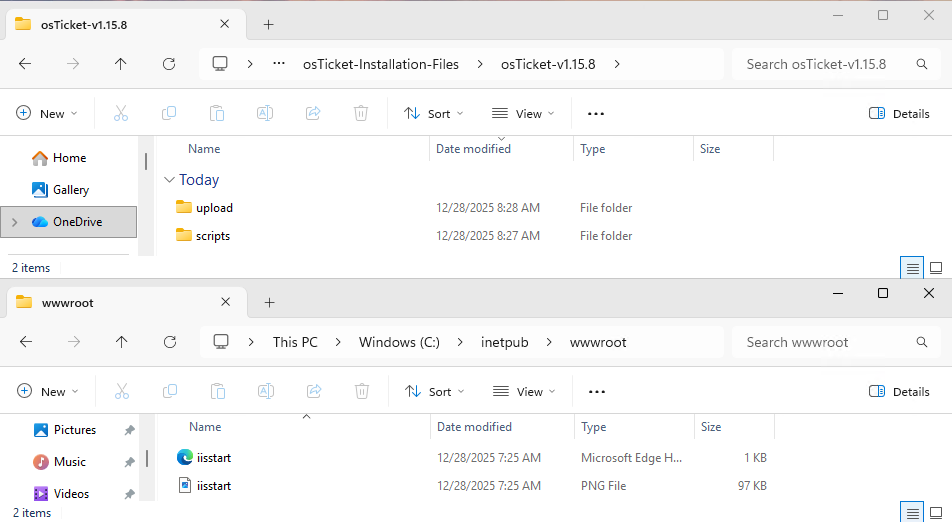

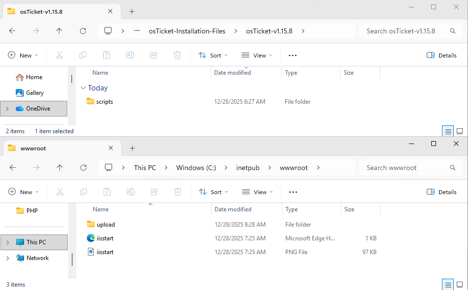

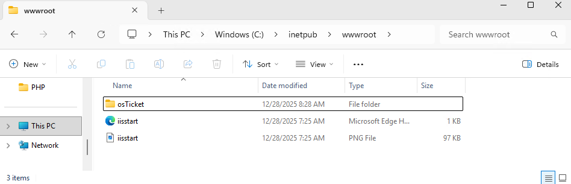

---

### Step 11: Launch osTicket Web Installer

**Goal:** Open the osTicket setup page in a browser and review the prerequisite checks.

**Procedure:**

1. Inside the RDP session, open Microsoft Edge.
2. Navigate to `http://localhost/osTicket/setup/`.
3. Review the **Prerequisites** list shown on the page.
4. Note any items marked as **failed** or **missing** (e.g. PHP extensions) — these will be fixed in Step 12.

**Result:** The osTicket installer page loads and displays the prerequisite checklist, with warnings visible for items needing correction.

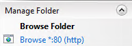

---

### Step 12: Configure PHP Extensions

**Goal:** Enable the PHP extensions required by osTicket so all installer prerequisites pass.

**Procedure:**

1. Inside the RDP session, open **IIS Manager** → **PHP Manager**.
2. Click **Enable or disable an extension**.
3. Enable the extensions osTicket requires (typically `php_imap.dll`, `php_intl.dll`, `php_ldap.dll`, `php_mbstring.dll`, `php_openssl.dll`, and `php_gd2.dll`).
4. Click **Apply**.
5. Alternatively, edit `C:\PHP\php.ini` directly: uncomment the matching `extension=…` lines (remove the leading `;`).
6. Restart IIS: open an elevated Command Prompt and run `iisreset`.
7. Return to the browser and refresh `http://localhost/osTicket/setup/`.
8. Confirm all prerequisites now show as **passed** (green).

**Result:** All required PHP extensions are enabled and the installer's prerequisite checklist passes.

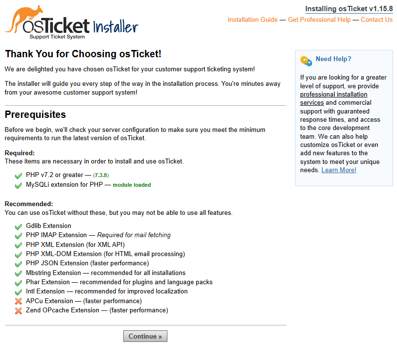

---

### Step 13: Configure osTicket Configuration File

**Goal:** Create osTicket's configuration file and give IIS temporary write access so the installer can populate it.

**Procedure:**

1. Inside the RDP session, open File Explorer and navigate to `C:\inetpub\wwwroot\osTicket\include\`.
2. Locate `ost-sampleconfig.php`.
3. Rename it to `ost-config.php`.
4. Right-click `ost-config.php` → **Properties** → **Security** → **Advanced**.
5. Click **Change** next to Owner → set the owner to `Administrators`.
6. In the permissions list, grant **Full control** to `Users` (temporary, for the installer).
7. Click **OK** on each dialog to apply.

**Result:** `ost-config.php` exists and is writable by IIS, allowing the installer to write database credentials into it.

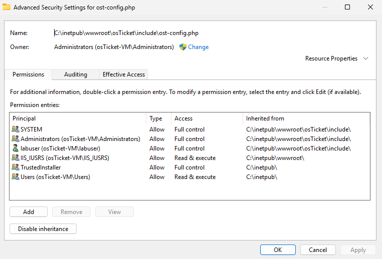

---

### Step 14: Create Database with HeidiSQL

**Goal:** Create the `osticket` database and a dedicated database user via HeidiSQL, so the installer can connect to MySQL.

**Procedure:**

1. Inside the RDP session, launch **HeidiSQL**.
2. In the session manager, create a new session:
   - **Hostname / IP:** `127.0.0.1`
   - **User:** `root`
   - **Password:** (the MySQL root password set in Step 8)
   - **Port:** `3306`
3. Click **Open** to connect.
4. In the query tab, run:
   ```sql
   CREATE DATABASE osticket;
   CREATE USER 'osticket'@'localhost' IDENTIFIED BY 'Str0ngP@ssw0rd!';
   GRANT ALL PRIVILEGES ON osticket.* TO 'osticket'@'localhost';
   FLUSH PRIVILEGES;
   ```
5. Right-click the left pane → **Refresh**.
6. Confirm the **osticket** database now appears in the tree.

**Result:** The `osticket` database exists and the `osticket` user has full privileges on it, ready for the installer.

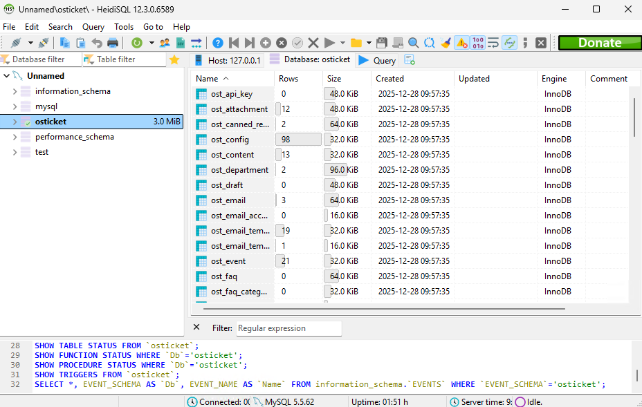

---

### Step 15: Complete Browser-Based Installation

**Goal:** Finish the osTicket installer by supplying help desk settings and database credentials.

**Procedure:**

1. Return to the browser at `http://localhost/osTicket/setup/`.
2. Scroll to the **System Settings** section and fill in:
   - **Helpdesk Name:** `osTicket Lab`
   - **Default Email:** your admin email address
3. Scroll to the **Admin User** section and fill in:
   - **First Name / Last Name**
   - **Email Address**
   - **Username:** `system_admin`
   - **Password:** (strong password, saved securely)
4. Scroll to the **Database Settings** section and enter:
   - **MySQL Hostname:** `localhost`
   - **MySQL Database:** `osticket`
   - **MySQL Username:** `osticket`
   - **MySQL Password:** (the password set in Step 14)
5. Click **Install Now**.
6. Wait for the installer to finish, then confirm the success page appears.

**Result:** osTicket is installed successfully and the admin account and database are configured.

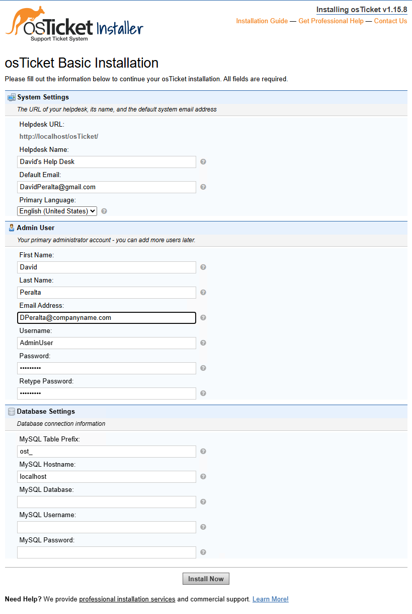

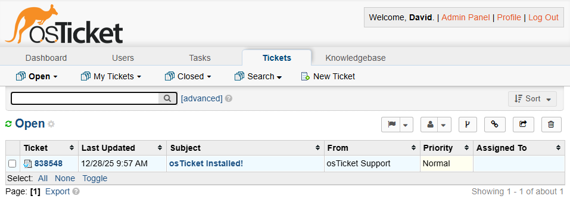

---

### Step 16: Verify End-User Portal

**Goal:** Confirm the osTicket support portal loads correctly and can accept tickets.

**Procedure:**

1. Inside the RDP session, open Microsoft Edge.
2. Navigate to `http://localhost/osTicket/`.
3. Confirm the **Support Center** page loads with the help desk name shown.
4. Click **Open a New Ticket** and confirm the ticket submission form appears.
5. (Optional) Navigate to `http://localhost/osTicket/scp/` and log in with the admin account to confirm the staff control panel loads.

**Result:** The osTicket support portal and staff control panel are both accessible, confirming a complete and working installation.

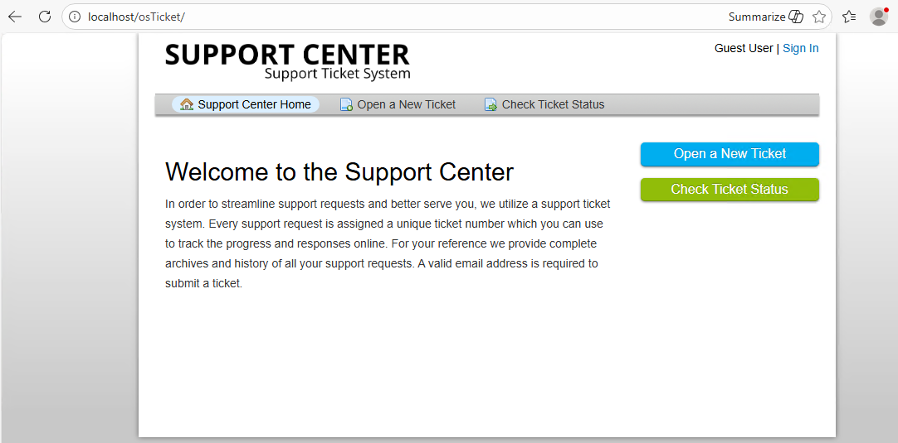

---

## Troubleshooting

- **PHP extensions not loading in the installer** — ensure the `extension=` lines in `C:\PHP\php.ini` are uncommented, then run `iisreset`. PHP Manager's "Enable or disable an extension" does the same thing.
- **"Database connection failed" in the installer** — verify the `osticket` user was created with `GRANT ALL PRIVILEGES ON osticket.*` and that the password in the installer matches what you set in HeidiSQL.
- **HTTP 500 error when opening osTicket** — usually a missing extension or an incorrect `php-cgi.exe` registration; re-check Step 9 and Step 12.

---

## Skills Demonstrated

- Microsoft Azure VM provisioning and networking
- Windows 11 / IIS administration
- PHP installation and configuration with PHP Manager
- MySQL Server installation and database/user creation via HeidiSQL
- Web application deployment (osTicket) and troubleshooting
- Technical documentation with step-by-step reproduction instructions

---
