

  

<h1 align="center">osTicket – Prerequisites & Installation (Lab)</h1>

  End-to-end technical deployment of the osTicket help desk system on Microsoft Azure

---

## 📌 Overview

This lab demonstrates the **full technical installation and configuration** of **osTicket**, an open-source help desk ticketing system, deployed on a **Microsoft Azure-hosted Windows virtual machine**.

The walkthrough documents each step performed during deployment, including virtual machine provisioning, IIS configuration, PHP installation, MySQL database setup, and osTicket installation.

All screenshots were captured **during execution** to demonstrate how the system was built from start to finish.

---

## 🖥️ Environment

- Microsoft Azure (Virtual Machines)
- Windows 11 Pro
- Internet Information Services (IIS) with CGI
- PHP 7.3.8
- MySQL Server 5.5
- Remote Desktop Protocol (RDP)
- HeidiSQL

---

## ⚙️ Installation & Configuration Steps

---

### Step 1: Provision the Azure Virtual Machine

**Goal:** Create a Windows 11 VM in Microsoft Azure to host the osTicket environment.

**Procedure:**

1. Sign in to the [Azure Portal](https://portal.azure.com) and click **Create a resource**.
2. Search for **Virtual Machine** and click **Create**.
3. On the **Basics** tab, configure:
   - **Resource group:** `osTicket` (create new)
   - **Virtual machine name:** `osTicket-VM`
   - **Region:** `(US) East US 2`
   - **Image:** `Windows 11 Pro`
   - **Size:** `Standard_D2s_v3` (2 vCPU, 8 GiB)
   - **Username:** `labuser`
   - **Password:** (strong password, saved securely)
4. On the **Networking** tab, set **Inbound port rules** to allow **RDP (3389)**.
5. Click **Review + create** → **Create**. Wait ~3–5 minutes for deployment.
6. Confirm the VM shows **Running** on its overview page.

**Result:** The VM is provisioned and running in Azure.

---

### Step 2: Connect via Remote Desktop

**Goal:** Establish an RDP session to the Azure VM so configuration can begin.

**Procedure:**

1. In the Azure Portal, open the `osTicket-VM` overview page.
2. Click **Connect** → **RDP**.
3. Click **Download RDP File**.
4. Open the downloaded `.rdp` file.
5. When prompted, enter the VM credentials:
   - **Username:** `labuser`
   - **Password:** (the password set during VM creation)
6. Accept the certificate warning if prompted (expected for a new VM).
7. Wait for the Windows desktop to load.

**Result:** An active Remote Desktop session showing the Windows 11 desktop of the Azure VM.

---

### Step 3: Download osTicket Installation Files

**Goal:** Obtain the osTicket package and extract it inside the VM.

**Procedure:**

1. Inside the RDP session, open Microsoft Edge.
2. Navigate to the osTicket releases page: `https://osticket.com/download/`.
3. Download the latest **osTicket v1.15.8** `.zip` package.
4. Once downloaded, right-click the `.zip` → **Extract All…**
5. Set the destination to `C:\Users\labuser\Downloads\osTicket-Installation-Files\` and click **Extract**.
6. Open the extracted folder and confirm you see the `upload` and `include` folders.

**Result:** The osTicket files are extracted locally on the VM, ready for deployment.

---

### Step 4: Install IIS with CGI Enabled

**Goal:** Install Internet Information Services (IIS) with the CGI feature enabled so IIS can execute PHP.

**Procedure:**

1. Inside the RDP session, open the Start menu and search for **Control Panel**.
2. Navigate to **Programs** → **Turn Windows features on or off**.
3. Check the box for **Internet Information Services**.
4. Expand **Internet Information Services** → **World Wide Web Services** → **Application Development Features**.
5. Check the box for **CGI**.
6. Click **OK** and wait for Windows to apply the changes.

**Result:** IIS is installed with CGI enabled, ready to host PHP.

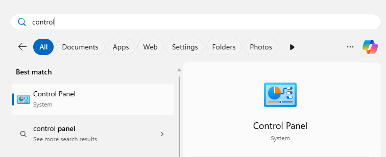

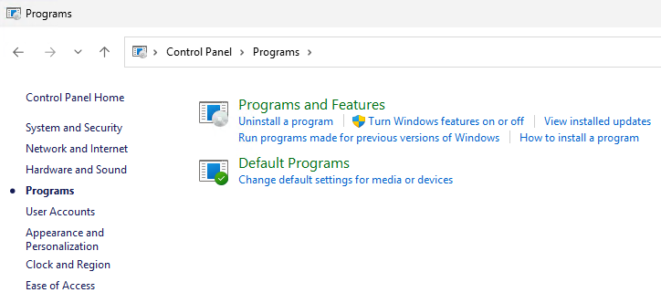

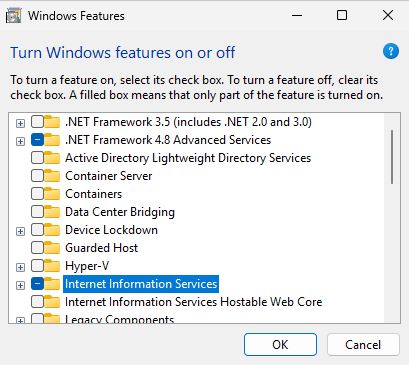

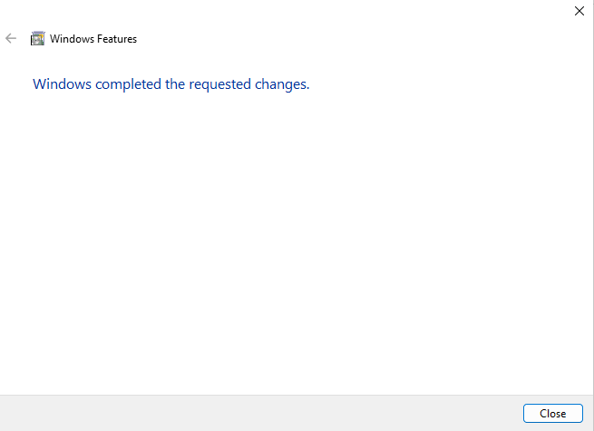

---

### Step 5: Install IIS Dependencies

**Goal:** Install PHP Manager for IIS and the IIS URL Rewrite Module — both required for osTicket to run correctly.

**Procedure:**

1. Inside the RDP session, download the **PHP Manager for IIS** installer.
2. Run the installer → **Next** → accept the license → **Install** → **Finish**.
3. Download the **IIS URL Rewrite Module 2** installer.
4. Run the installer → accept the license → **Install** → **Finish**.
5. Close and reopen **IIS Manager** (`inetmgr`) so the new modules load.
6. Confirm **PHP Manager** appears in the IIS Manager home page.

**Result:** Both dependencies are installed and PHP Manager is visible in IIS Manager.

---

### Step 6: Install PHP Runtime

**Goal:** Install PHP 7.3.8 to `C:\PHP` so IIS can execute PHP scripts.

**Procedure:**

1. Inside the RDP session, open File Explorer and navigate to the `C:` drive.
2. Create a new folder named `PHP`.
3. Download the **PHP 7.3.8 (x64) Non-Thread-Safe** ZIP from `windows.php.net/downloads/releases/archives/`.
4. Right-click the ZIP → **Extract All…**
5. Set the destination to `C:\PHP` and click **Extract**.
6. Confirm `C:\PHP\php-cgi.exe` exists (this is the binary IIS will call).
7. Copy `php.ini-production` to `php.ini` in the same folder.

**Result:** PHP 7.3.8 is extracted to `C:\PHP` with a working `php.ini`.

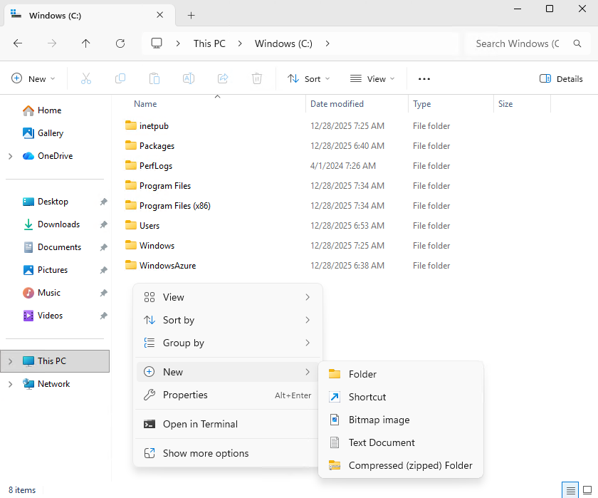

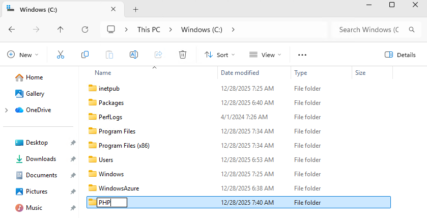

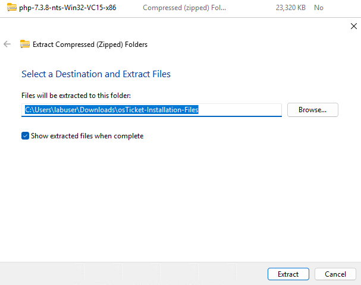

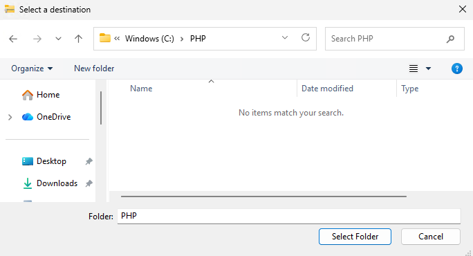

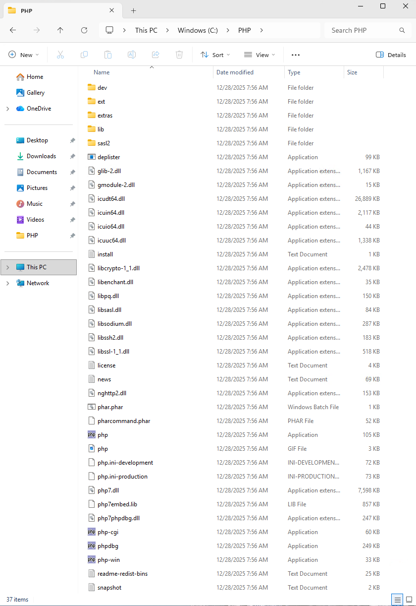

---

### Step 7: Install Microsoft Visual C++ Redistributable

**Goal:** Install the Visual C++ Redistributable required by PHP and MySQL.

**Procedure:**

1. Inside the RDP session, download the **Microsoft Visual C++ Redistributable** installer (x64).
2. Run the installer.
3. Check **I agree to the license terms and conditions**.
4. Click **Install**.
5. Wait for setup to complete, then click **Close**.

**Result:** The Visual C++ Redistributable is installed, satisfying the runtime dependency for PHP and MySQL.

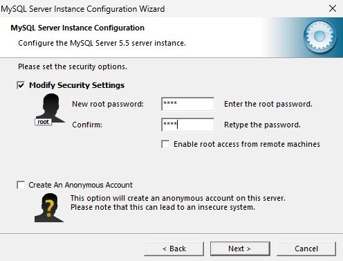

---

### Step 8: Install MySQL Server

**Goal:** Install MySQL Server to serve as the backend database for osTicket.

**Procedure:**

1. Inside the RDP session, open Microsoft Edge and navigate to the MySQL Community Downloads archive to locate the **MySQL Server 5.5** installer (`.msi`).
2. Once the download is complete, double-click the `.msi` file to launch the setup wizard.
3. On the **Welcome** screen, click **Next** to begin the installation.
4. Accept the license agreement terms and click **Next**.
5. On the Setup Type screen, select **Typical** and click **Install**.
6. Wait for the progress bar to complete, then click **Next** and **Finish**.
7. The MySQL Configuration Wizard will launch automatically. Select **Standard Configuration** and click **Next**.
8. Check the box for **Install As Windows Service** (leave the default service name as `MySQL`). Ensure "Launch the MySQL Server automatically" is checked, then click **Next**.
9. Set a secure **root password** (make sure to save this securely, as it will be needed later for HeidiSQL) and click **Next**.
10. Click **Execute** to apply the configuration. Once all checkmarks turn green, click **Finish**.

**Result:** MySQL Server is installed, running as a Windows service, with a known root password.

---

### Step 9: Register PHP in IIS

**Goal:** Register PHP with IIS via PHP Manager so IIS can execute `.php` files.

**Procedure:**

1. Inside the RDP session, open the Windows Start menu and search for **Internet Information Services (IIS) Manager**. Right-click it and select **Run as administrator** to launch the console.

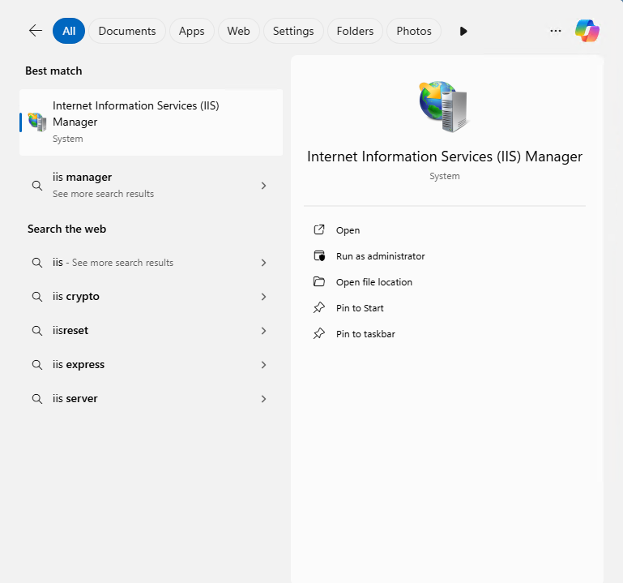

2. In the IIS Manager window, click on the server name (e.g., `osTicket-VM`) in the left-hand **Connections** tree.
3. Expand **Sites** → **Default Web Site**, and click on the **osTicket** folder to select it.
4. In the center **Features View** pane, double-click the **PHP Manager** icon.

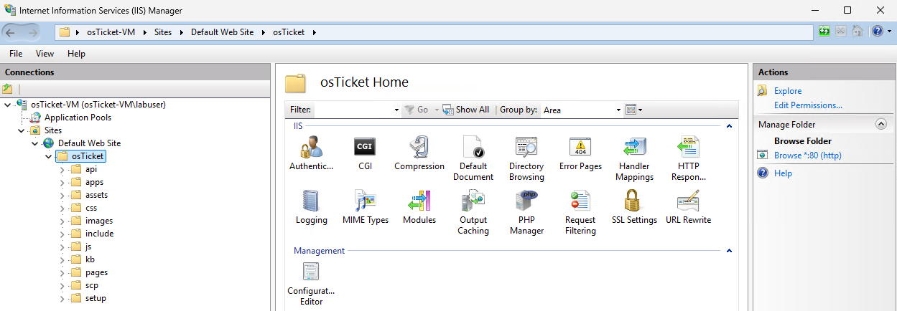

5. You will see a warning stating "PHP is not enabled." Click the **Register new PHP version** link.

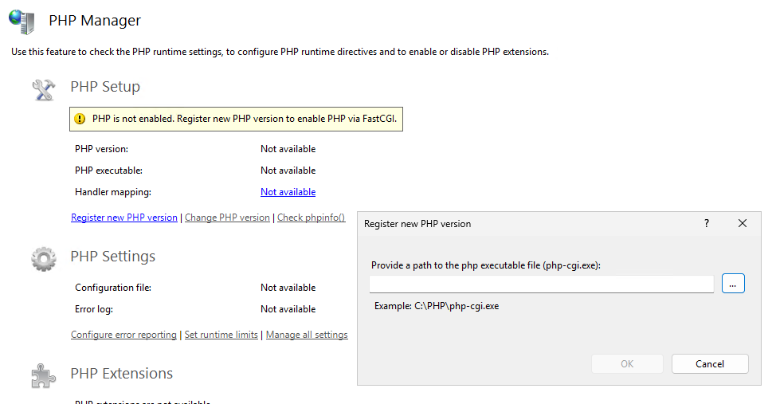

6. A popup window will appear asking for the path to the `php-cgi.exe` file. Click the **`...`** (browse) button.
7. In the file explorer window, navigate to `C:\PHP\`, select the `php-cgi.exe` application file, and click **Open**.

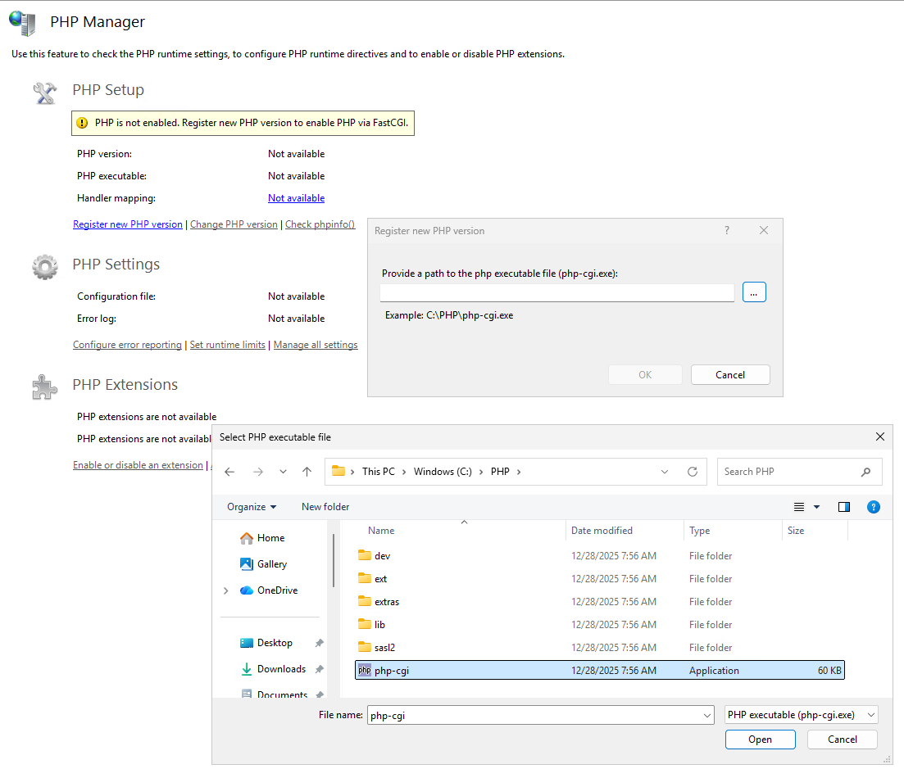

8. Click **OK** to close the popup and register the version.
9. Refresh the PHP Manager page to confirm that PHP 7.3.8 is now listed and the warning is gone.

**Result:** PHP 7.3.8 is registered with IIS and listed in PHP Manager.

---

### Step 10: Deploy osTicket Application Files

**Goal:** Copy the osTicket `upload` folder into IIS's web root and rename it to `osTicket`.

**Procedure:**

1. Inside the RDP session, open **File Explorer**.
2. Navigate to the extracted osTicket folder located at `C:\Users\labuser\Downloads\osTicket-Installation-Files\osTicket-v1.15.8\`.
3. Right-click the `upload` folder and select **Copy**.
4. In the address bar, navigate to `C:\inetpub\wwwroot\`.
5. Right-click in the empty space and select **Paste**. Confirm `C:\inetpub\wwwroot\upload\` now exists.

6. Right-click the `upload` folder inside `wwwroot` → **Rename** → change it to `osTicket`.

7. Confirm the path is now `C:\inetpub\wwwroot\osTicket\` and that all application files (api, assets, include, etc.) are inside.

**Result:** osTicket application files are deployed at `C:\inetpub\wwwroot\osTicket\`, ready for the web installer.

---

### Step 11: Launch osTicket Web Installer

**Goal:** Open the osTicket setup page in a web browser to review the prerequisite checks.

**Procedure:**

1. Inside the RDP session, open **Microsoft Edge**.
2. In the address bar, type the exact URL of your newly deployed folder: `http://localhost/osTicket/setup/` and press Enter.
3. Review the **Prerequisites** list shown on the installer page.
4. Note the items marked with a red **X** (e.g., PHP IMAP Extension, Intl Extension). These are required or recommended extensions that are currently missing and will be fixed in Step 12.

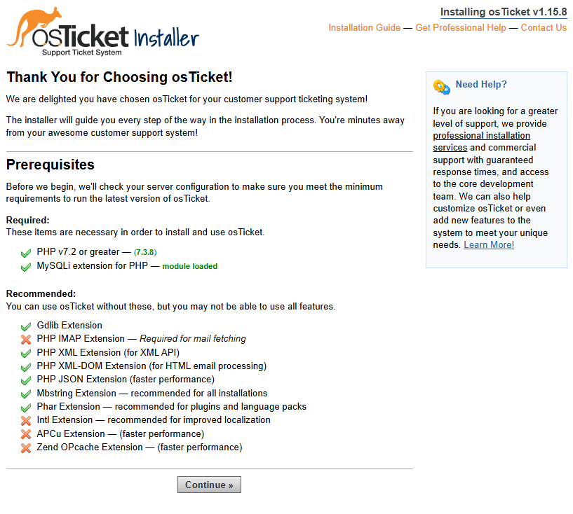

**Result:** The osTicket web installer launches successfully and displays the prerequisite checklist, highlighting missing PHP extensions.

---

### Step 12: Configure PHP Extensions

**Goal:** Enable the PHP extensions required by osTicket so all installer prerequisites pass.

**Procedure:**

1. Inside the RDP session, return to **Internet Information Services (IIS) Manager**.
2. In the left-hand tree, click on the **osTicket** folder. In the center pane, double-click the **PHP Manager** icon.

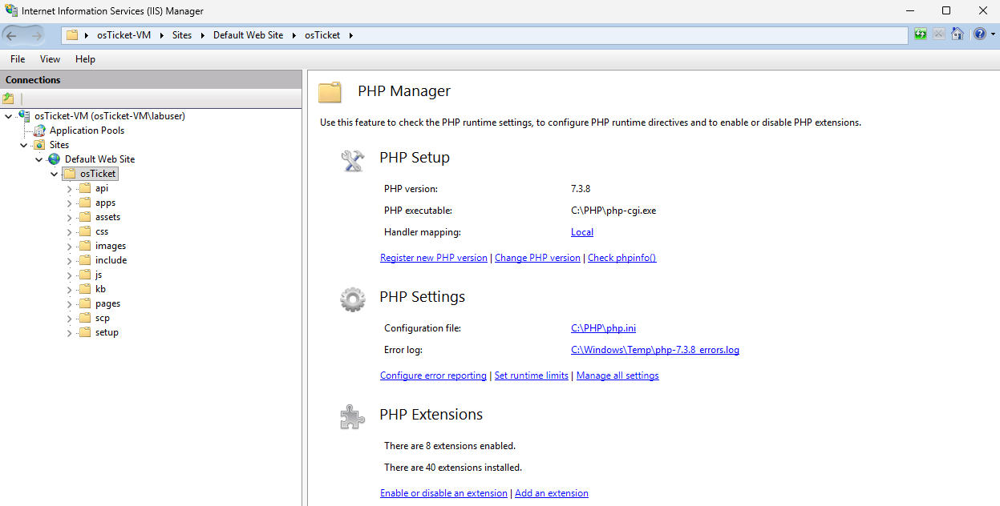

3. Under the PHP Extensions section, click the **Enable or disable an extension** link.

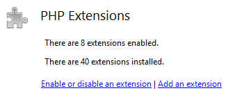

4. Locate the missing extensions (such as `php_imap.dll` and `php_intl.dll`). Right-click on `php_imap.dll` and select **Enable**.

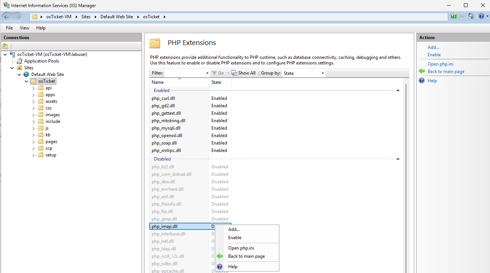

5. Repeat this process to enable `php_intl.dll`, `php_ldap.dll`, and `php_gd2.dll`. 
6. Verify that all required extensions now show a state of **Enabled**.

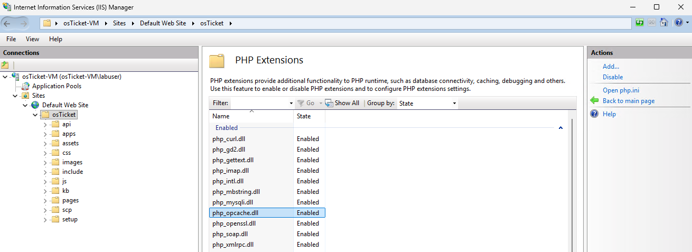

7. Return to the Microsoft Edge browser and refresh the `http://localhost/osTicket/setup/` page.
8. Confirm that all the previously missing prerequisites now show as **passed** (green checkmarks).

**Result:** All required PHP extensions are enabled and the installer's prerequisite checklist passes.

---

### Step 13: Configure osTicket Configuration File

**Goal:** Create osTicket's configuration file and give IIS temporary write access so the installer can populate it.

**Procedure:**

1. Inside the RDP session, open File Explorer and navigate to `C:\inetpub\wwwroot\osTicket\include\`.
2. Locate the file named `ost-sampleconfig.php`.

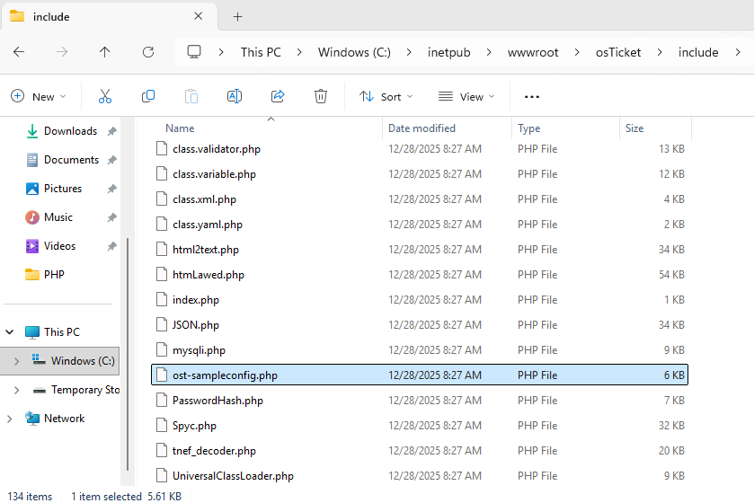

3. Right-click `ost-sampleconfig.php` and select **Rename**. Change the name to `ost-config.php`.

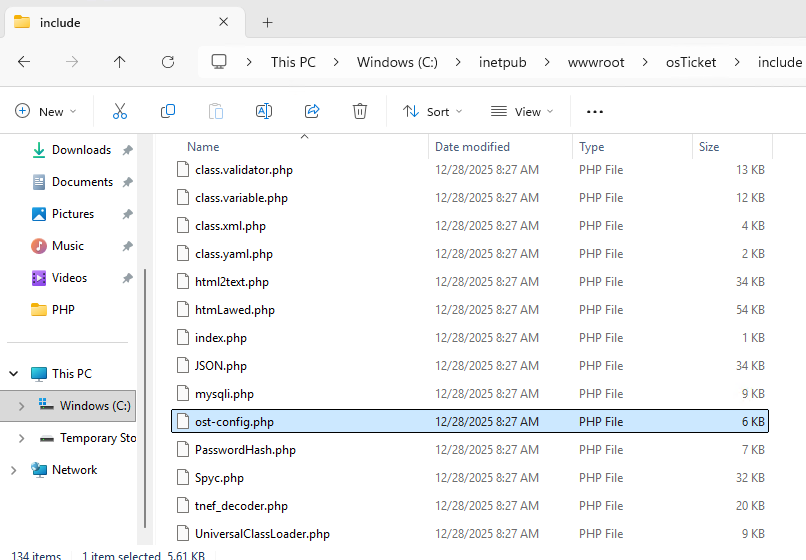

4. Right-click `ost-config.php` and select **Properties**.

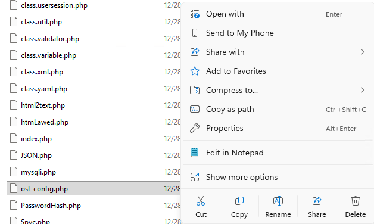

5. Navigate to the **Security** tab.

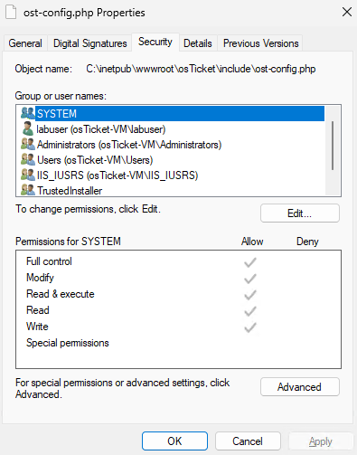

6. Click the **Advanced** button to view the current inherited permissions.

7. Click **Disable inheritance**, and choose **Convert inherited permissions into explicit permissions on this object**.

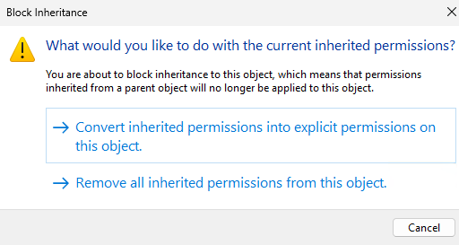

8. Click **Add**, type `Everyone`, and click **OK**.

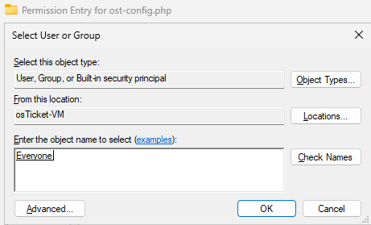

9. Check the box for **Full control** and click **OK**.

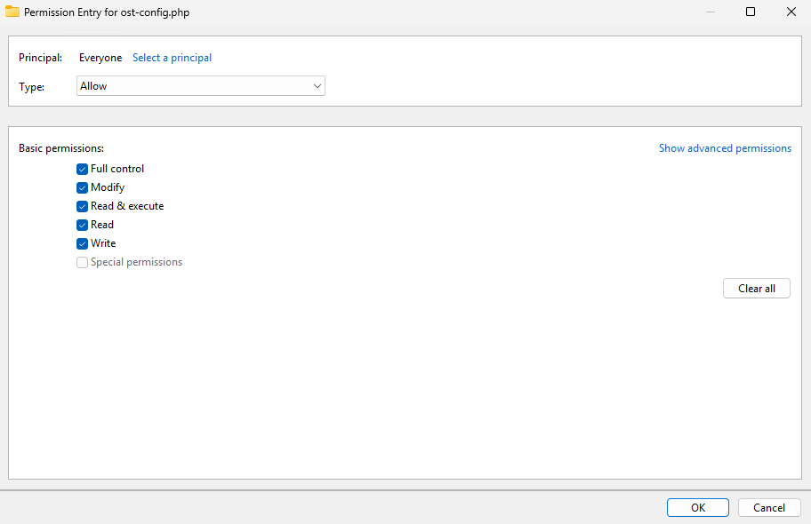

10. Click **Apply** and **OK** on all remaining dialogs to save the permissions.

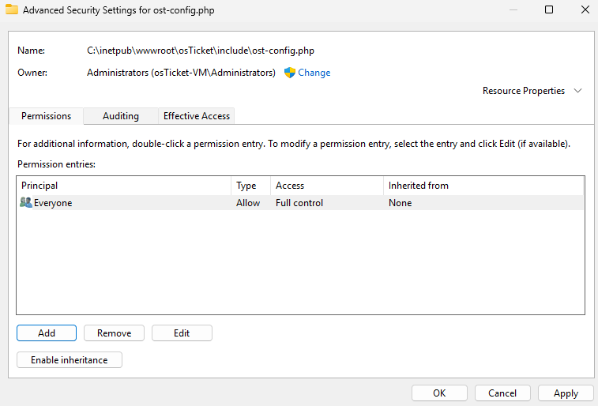

**Result:** `ost-config.php` exists and is writable by IIS, allowing the installer to write database credentials into it.

---

### Step 14: Create Database with HeidiSQL

**Goal:** Create the `osticket` database and a dedicated database user via HeidiSQL, so the installer can connect to MySQL.

**Procedure:**

1. Inside the RDP session, launch the **HeidiSQL** installer. Accept the license agreement and proceed with the installation.

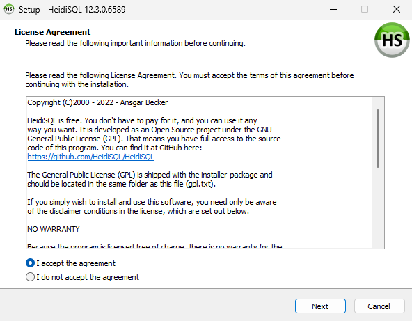

2. Once installed and launched, you will be greeted by the **Session Manager**. Click **New** to create a new connection.

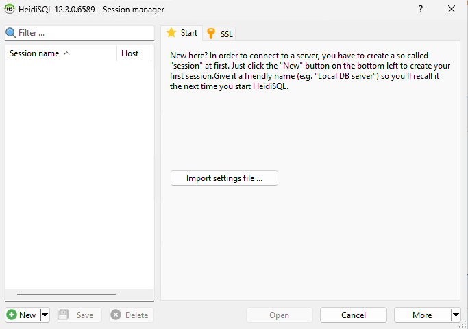

3. Configure the session settings:
   - **Network type:** MariaDB or MySQL (TCP/IP)
   - **Hostname / IP:** `127.0.0.1`
   - **User:** `root`
   - **Password:** (the MySQL root password set in Step 8)
   - **Port:** `3306`
4. Click **Open** to connect to the database.

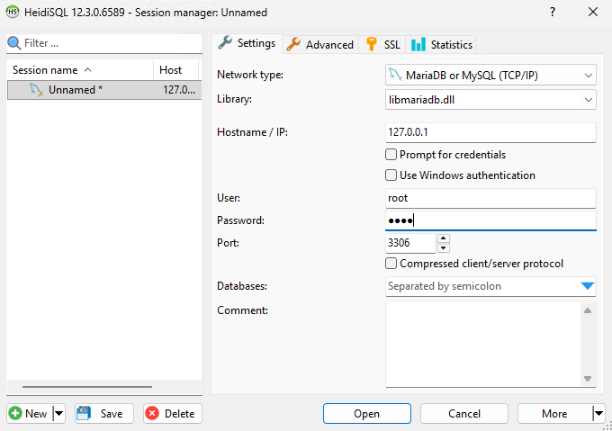

5. In the left-hand pane, right-click on your connection name and select **Create new** → **Database**.

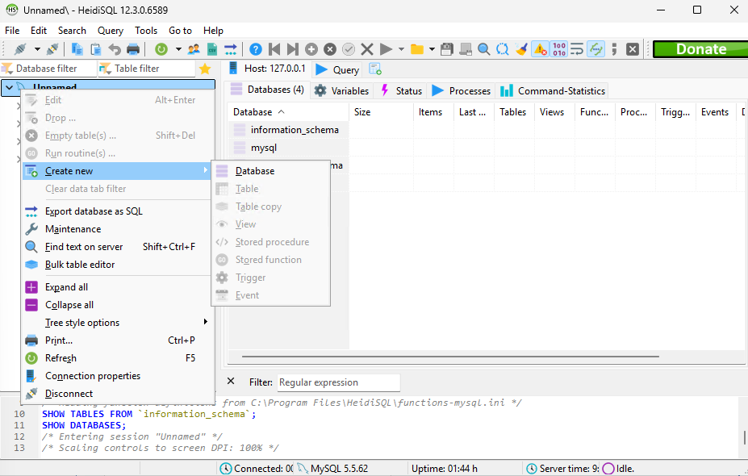

6. Name the database `osTicket` (or `osticket`) and click **OK**.

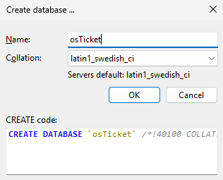

7. Verify the database appears in the left-hand pane.

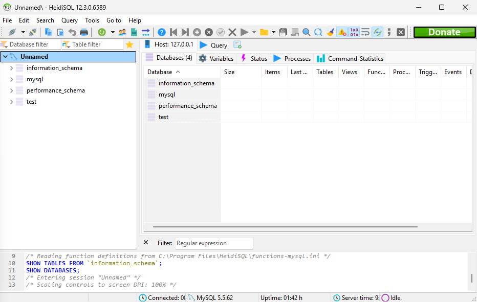

8. Click on the `osTicket` database. It will initially be empty.

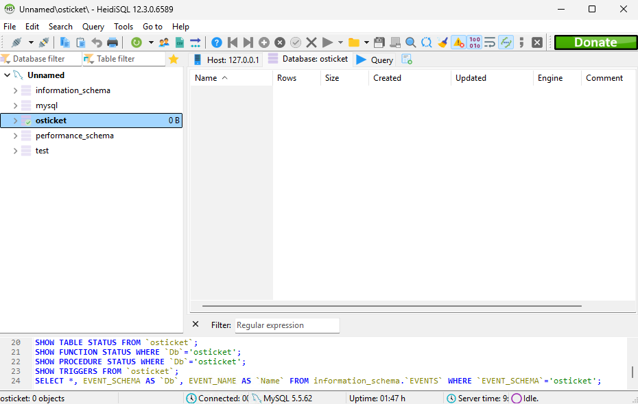

9. (Optional) If you need to view the database connection details within the web installer, ensure the fields are ready to be filled.

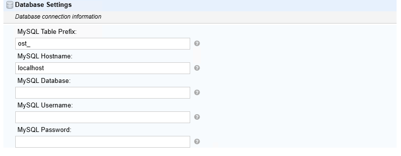

**Result:** The `osTicket` database is created and ready for the installer to populate with tables.

---

### Step 15: Complete Browser-Based Installation

**Goal:** Finish the osTicket installer by supplying help desk settings and database credentials.

**Procedure:**

1. Return to the browser at `http://localhost/osTicket/setup/`.
2. Scroll down to the **System Settings** section and fill in:
   - **Helpdesk Name:** `David's Help Desk`
   - **Default Email:** Your admin email address
3. In the **Admin User** section, fill in your first name, last name, email, username (e.g., `AdminUser`), and a strong password.
4. In the **Database Settings** section, enter:
   - **MySQL Hostname:** `localhost`
   - **MySQL Database:** `osTicket`
   - **MySQL Username:** `root`
   - **MySQL Password:** (the root password set in Step 8)
5. Click **Install Now**.

6. Wait for the installer to finish, then confirm the success page appears.

7. The success page provides useful links for your Helpdesk URL and Staff Control Panel. 

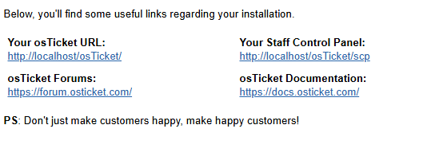

**Result:** osTicket is installed successfully and the admin account and database are configured. *Note: You must now remove write access from `ost-config.php` as instructed on the success page.*

---

### Step 16: Verify End-User Portal & Staff Login

**Goal:** Confirm the osTicket support portal loads correctly and the admin can log in.

**Procedure:**

1. Inside the RDP session, open Microsoft Edge.
2. Navigate to `http://localhost/osTicket/`.
3. Confirm the **Support Center** page loads with the help desk name shown.

4. Navigate to the Staff Control Panel at `http://localhost/osTicket/scp/`. 
5. Log in with the admin credentials created during the installation.

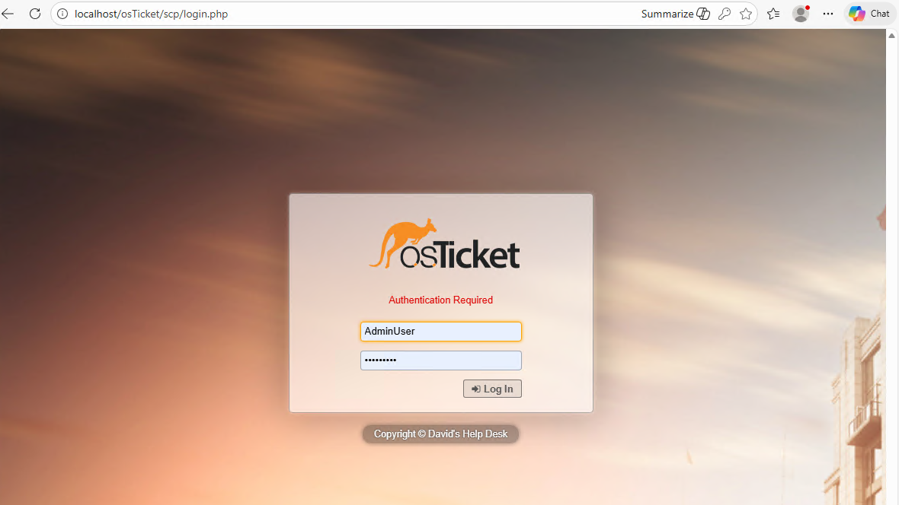

6. Once logged in, verify that the Admin Dashboard loads successfully and shows the "osTicket Installed!" ticket.

**Result:** The osTicket support portal and staff control panel are both accessible, confirming a complete and working installation.

---

## Troubleshooting

- **PHP extensions not loading in the installer** — ensure the `extension=` lines in `C:\PHP\php.ini` are uncommented, then run `iisreset`. PHP Manager's "Enable or disable an extension" does the same thing.
- **"Database connection failed" in the installer** — verify the `osticket` user was created with `GRANT ALL PRIVILEGES ON osticket.*` and that the password in the installer matches what you set in HeidiSQL.
- **HTTP 500 error when opening osTicket** — usually a missing extension or an incorrect `php-cgi.exe` registration; re-check Step 9 and Step 12.

---

## Skills Demonstrated

- Microsoft Azure VM provisioning and networking
- Windows 11 / IIS administration
- PHP installation and configuration with PHP Manager
- MySQL Server installation and database/user creation via HeidiSQL
- Web application deployment (osTicket) and troubleshooting
- Technical documentation with step-by-step reproduction instructions

---
